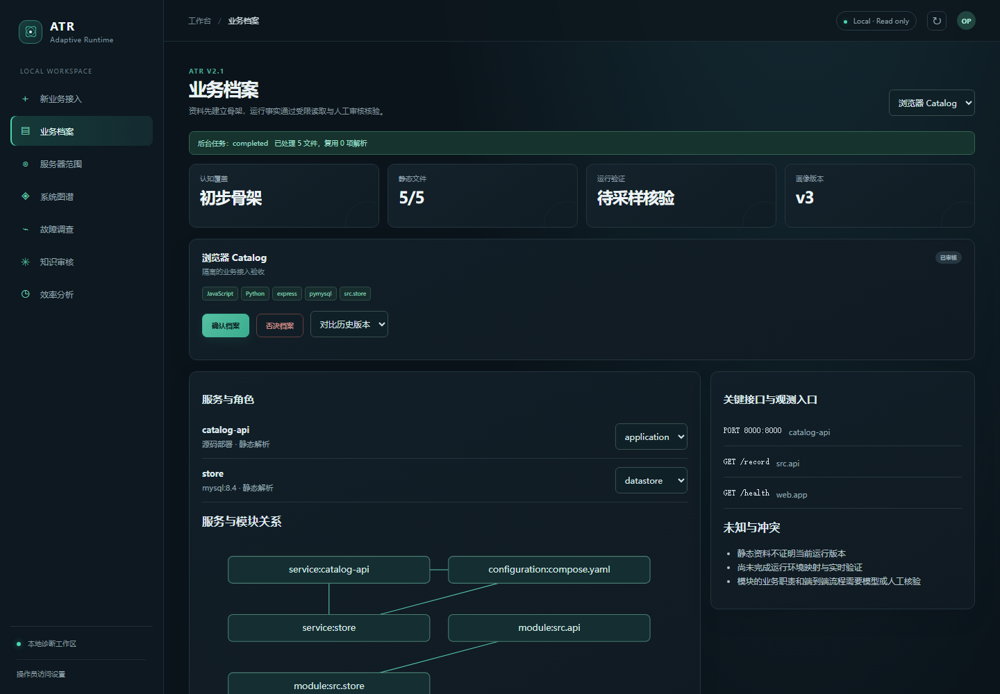
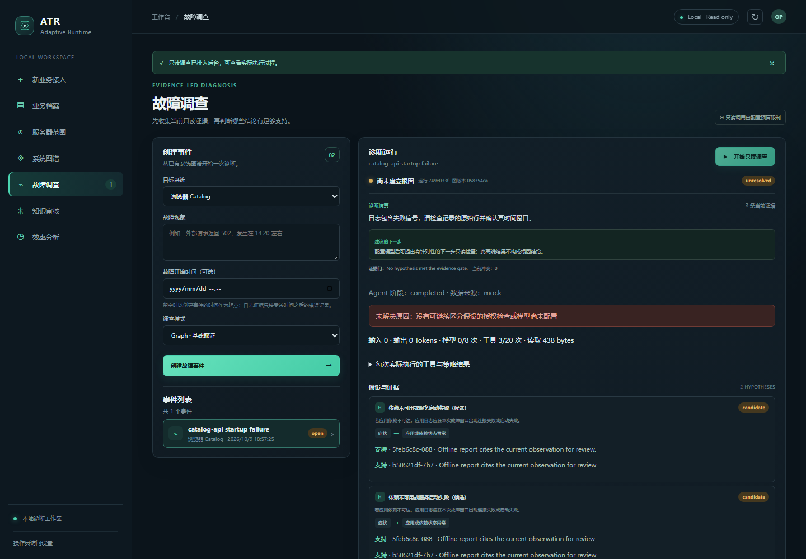

# ATR V2.1 验收报告

日期：2026-10-09（Asia/Shanghai）。基线上游：main / `73f3603a1df633d7bffe2d9d98b411b6a1e9bc68`。本版增量保留原功能，并交付代码、中文工作台、API、自动测试和部署/使用/安全/预算文档。开发与测试未访问真实业务服务器；源码同步不包含凭据或本地业务数据。

## 真实运行结果

最终完整命令 `python -m pytest -q --junitxml=docs/test-results.xml`：

```text
67 passed in 50.49s
```

[JUnit 原始结果](test-results.xml) 记录 tests=67、failures=0、errors=0、skipped=0。本机 Python 3.13.3、Node 24.14.1、Windows 原生环境；测试使用隔离临时 SQLite/文件目录、明确 Mock、回环 HTTP/SSH。没有真实供应商或生产主机。

| 检查 | 实际结果 | 能证明的范围 |
|---|---|---|
| 全量 pytest | 67 通过，无跳过 | 下列安全/业务/预算/协议/浏览器场景 |
| npm run build | TypeScript 与生产 JS/CSS 构建成功 | 当前前端可编译，浏览器另有真实测试 |
| Ruff check backend collector scripts tests | All checks passed | 配置的 E4/E7/E9/F/I 质量规则 |
| uv lock --check | 107 packages，锁一致 | 依赖声明与锁一致，非所有 OS 包运行验收 |
| 根 Compose 默认/profile + A/B Compose config | 均通过 | Compose 配置可解析，未代表容器启动 |
| git diff --check | 通过（Git 提示 LF/CRLF 转换） | 已跟踪改动无空白错误 |

## 测试构成

| 文件 | 用例数（含参数化） | 覆盖 |
|---|---:|---|
| test_baseline.py | 5 | 原 A/B 图谱、12 服务、角色/秘密、Gate 重复/时效/离线/反证 |
| test_regressions.py | 4 | Docker Titles 行、匹配循环状态、迁移/备份、等价/格式变化 Pattern |
| test_ingestion.py | 14 | Zip Slip 8 路径、链接/炸弹、TAR 特殊成员、非执行、多模块、类型/数量/YAML |
| test_business.py | 5 | 空业务、导入/索引/人审/增量/历史、250 无关文件、恶意包、媒体待处理 |
| test_budget.py | 3 | 硬预检、增额、usage/估算/预留、工具/字节 |
| test_additional_security.py | 12 | 正常 TAR/TAR.GZ/TGZ、秘密含空格/JSON、私钥不回显、API 低预算恢复、大小/深度/跨业务 |
| test_runtime.py | 11 | 候选审核、无关对象、任意命令/参数/目录/Docker 拒绝、权限/超时/断连、冲突/主机密钥/禁用 SSH |
| test_investigation.py | 3 | 完整离线业务链、未经审核不读取、测试 provider 受控故障与真实 Gate |
| test_ssh_protocol.py | 3 | 真 Paramiko 回环握手、固定入口+stdin JSON、错误主机密钥、超时 |
| test_gateway_and_source.py | 3 | 旧入口目录剪枝、网关服务器策略/容器 stderr、其他 SSH 入口拒绝 |
| test_profile_security.py | 2 | 恶意提示及模型非法关系不执行、显式数据库客户端关系/最新人工角色保留 |
| test_trusted_pattern.py | 1 | 人工修复记录、实际回环 GET 200、Candidate/审核/Trusted 顺序 |
| e2e/test_browser.py | 1 | Chromium + 真 Uvicorn/API，全链接入/取码/确认/调查，无 pageerror |

## A–H 要求对应

| 场景 | 验证结果与限制 |
|---|---|
| A 复杂源码压缩包 | Python/JS/Compose/README 安全解析、模块/导入/API/索引可查；顶层抛错源码仍仅解析；初始请求不含 def record 正文 |
| B 大量无关文件 | 250 个 node_modules 文件不会扩大有效模块；初始摘要条数/字节预算限制；发现显示无关运行对象。未做 200 MiB 压力跑满 |
| C 资料缺失 | 名称创建空画像/空图，标 insufficient，不伪造服务；保留受限环境入口 |
| D 资料/运行冲突 | MySQL 资料与显式 Mock PostgreSQL 配置双方事实保留，冲突可审核，不覆盖。非真实服务器观测 |
| E 预算不足 | 10 输入预算阻止 provider 进入，静态资料保留；增额后测试 provider 单次调用，actual usage 标识与累计保留 |
| F 恶意上传 | 穿越、绝对/Windows/控制路径、炸弹、链接/设备、类型伪装、限额、YAML 别名及恶意提示测试通过；无任意资料代码执行路径 |
| G SSH 边界 | 任意 shell、非法服务/目录、未授权 Docker/服务拒绝有审计；真回环 SSH 错误主机密钥/固定协议/超时通过；权限/断连由显式 Mock 验证 |
| H 完整接入 | 真浏览器/API 上传→解析→画像→审核→Mock 关联→发现→确认→融合→只读调查通过；无模型则明确 unresolved。另有测试 provider 的受控 supported 分支 |

## 浏览器证据

以下截图来自最终通过的自动化浏览器测试，不是设计稿或后端响应替身：





调查截图明确显示数据来源 mock、模型调用为零、未解决原因；没有把受控演示显示为真实服务器诊断成功。

## 各阶段结论

- Phase 0 基线 Bug 修复与原 Demo 本地解析回归通过；原 Docker Demo 运行验收仍缺 Engine。
- Phase 1 安全资料导入和中文页面通过自动化测试。
- Phase 2 画像、审核、版本、局部检索、预算及模型接口控制测试通过；真实语义质量/供应商尚未验证。
- Phase 3 定向范围、Policy、回环 SSH 与错误路径通过；真实 Linux 上账号权限、网关 openat/systemd/journal 未运行验收，不能宣称此阶段真实服务器验收完成。
- Phase 4 受控 Mock 故障与图谱/Agent/Gate 全链通过；不是任意陌生业务根因准确率验证。
- Phase 5 测试和文档交付完成，保留下面待验证能力，不虚构上线结论。

## 未完成与未验证

1. 无真实授权 Linux 主机：需所有者提供经核对主机公钥、受限凭据及允许业务范围，先验证只读权限，再做定向发现、失败/超时/断连与审计。未自动更改服务器、安装软件或提权。
2. Docker Desktop 已安装但 Engine 未运行：仅验证 Compose config；镜像构建、两个 Demo 的启动/网络/人工修复/Pattern 迁移需后续运行。
3. 无真实模型 API：结构化请求、usage、无效/预算路径使用测试 stub；真实 usage 格式、额外计费、推理质量/费用尚未验证。
4. 图片/PDF 自动理解未实现，独立待处理接口与人工录入已交付。JS/TS 正则解析和 Python 调用关系覆盖有限，FTS 不是全文检索。
5. 本地画像骨架仍整体重建；解析按哈希复用并保留审核/知识，但尚无完整依赖影响最小子图算法。
6. 历史/失败文件不自动物理清理；单 API 进程/单操作员，未实现多租户、通用任务队列、完整进程深读。尚未压测最大上传集合或长时间并发稳定性。
7. Evidence Gate 不等同自然语言因果证明；未测真实业务成功率或跨系统效率提升，不报告模拟成功率。

优先下一阶段：授权 Linux 验收 → 真实模型及 Docker Demo → 更丰富业务故障用例 → 媒体/语言语义索引与资料保留策略。

## 交付入口

[启动](../README.md) · [部署与恢复](deployment.md) · [接入操作](business-onboarding.md) · [新增 API](api-v2.1.md) · [架构](v2.1-architecture.md) · [审计/变更](audit-v2.1.md) · [安全](security-boundaries.md) · [预算](context-budget.md) · [完整能力状态](implementation-status.md)
