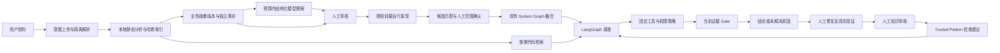

# ATR V2.1 架构

## 增量范围与数据流

上游基线：`73f3603a1df633d7bffe2d9d98b411b6a1e9bc68`。继续使用 FastAPI、Pydantic、SQLite、React、LangGraph、LiteLLM 及现有图谱/Pattern 表。保留原四页面和 V1 入口；调查启动改为 202 后台任务响应，调用方须轮询 jobs。

## 模块复用与职责

| 模块 | 实现位置（backend/app 下） | 职责 |
|---|---|---|
| 原系统接入 | system/compose_parser.py、source_parser.py、inventory.py、graph.py | 保留 Compose；修复角色、扫描限制与等价判断 |
| 资料处理 | business/ingestion.py、worker.py、resources.py、static.py、media.py | 受控目录、安全解包、限资源子进程、本地解析、媒体待处理 |
| 业务知识 | business/models.py、profile.py、service.py | 画像、五类来源事实、审核、冲突与增量版本 |
| 源码工具 | business/source_index.py | FTS5 元数据检索及带摘要/版本的局部读取 |
| 预算/模型 | context/budget.py、model.py | 原子预留、usage 结算、LiteLLM JSON 调用 |
| 运行读取 | connectors/models.py、policy.py、ssh.py、mock.py、service.py | 固定工具、主机密钥、凭据引用、显式 Mock、持久审计 |
| 范围/融合 | system/scope.py、business_graph.py | 轻量发现、候选审核、来源融合、冲突及图谱版本 |
| 调查 | agent/business_investigation.py、workflow.py、tools/business.py | 复用 LangGraph/Gate，已审核业务优先、源码检索、预算 |
| API/任务 | api/business.py、api/v1.py、jobs.py、main.py | 认证、异步任务、恢复中断和原 API 兼容 |

`frontend/src/business.tsx`、`api.ts`、`main.tsx` 扩展为中文七页工作台。`scripts/ssh_gateway.py` 是管理员可手动部署的 Linux 固定入口，ATR 不自动部署它。

## 本地知识与按需源码

Fact 独立记录 subject、predicate、object、source_type、source_locator、source_digest、observed_at、confidence、verification_status。Documented、Static、Runtime、Inferred、Human Verified 与审核状态相互独立：人工确认旧资料不等于当前运行状态成立。无法确认职责/关系时保持 unknown 或 Inferred，空业务创建空图。

文件保存在 `<ARTIFACT_ROOT>/<business_id>/<artifact_id>/`。SQLite 只存元数据、解析索引和结构化事实，不存大型源码/二进制。首次生成服务、模块、接口、配置、依赖骨架；全文不进入初始模型上下文。模型只收到限额摘要和选取的文件索引。

FTS5 覆盖路径、符号、导入与路由元数据，不是源码全文搜索。局部读取验证业务、画像版本、file_id、路径及 SHA256，最多 160 行。大于读取上限的文件不开放局部接口。Python 使用 AST，JS/TS 使用有限正则；动态导入、别名、运行时路由分析不完整。

## 增量与审核

append 新增资料，replace 替换同一 slot 的当前资料。哈希未变复用解析，修改/新增重新解析，删除停止参与当前索引并将知识标为 stale。历史版本仍可读原文件。稳定 slot/path/digest 维持未变事实身份和审核；已确认推断、人工角色及运行冲突不会因小变更全部清空。

骨架在本地重建并发布版本，当前不是完整依赖影响计算器。未影响事实的变更复用模型结论，确有变化则待审核/待模型。人工操作携带 expected_version，过期版本拒绝；审计保存操作者、依据、对象摘要、版本。重设角色使旧人工角色事实 stale。

## 运行范围与图谱融合

首次发现仅取 OS、进程名称、监听端口、systemd、可选 Docker 元数据及允许目录单层文件名。按名称、镜像、端口、键名形成排名与依据，全部 pending。确认绑定前不允许业务 service/container 深读；重新发现会使旧绑定 stale，需要复核。

复用 graph_snapshots、graph_nodes、graph_edges、fact_claims、conflicts。节点覆盖 host/service/container/process/module/api/datastore/configuration/network_endpoint；关系覆盖 depends_on/runs_on/exposes/calls/connects_to/configured_by/observed_as。显式静态数据库客户端调用只提供 connects_to 线索。图片/PDF 目前由人工文本形成 Documented，未自动识别拓扑。

为兼容 V1 fact_claims.truth_type 的 CHECK 枚举，旧列映射为 static/deployment/runtime，真实五类来源在 value.provenance 中，API 另返回 source_type。消费者应读取真实来源。冲突保存双方事实，发布待审图谱版本，不能直接覆盖旧知识。

图谱语义摘要基于排序节点角色/属性与关系，等价重新生成不自动废弃 Trusted Pattern。实际语义改变使旧绑定待复核。当前匹配仍检查角色、拓扑、工具能力、症状，不能以历史结论代替当前证据。

## 调查与 Evidence Gate

已审核档案与 confirmed 运行范围是新业务调查前提。Python 按症状服务或应用角色及声明依赖选择有限状态/日志。模型从授权动作选择后续读取/代码检索；参数由 Python 产生，Policy 再审。步骤、工具、证据、假设支持/反证、usage 和预算停止原因持久化。

Gate 要求当前快照目标、事件窗口内可追踪观测、目标或有效声明依赖范围、失败信号、内容去重和不同工具族、支持链接解释、因果链/预测、无关键未解决冲突。静态代码、历史 Pattern 和离线结果不能单独 supported。Gate 可核查来源、时效、范围、重复和信号，不能证明所有自然语言因果判断都正确。

## 持久化、任务与恢复

新增表：business_profiles、business_profile_versions、uploaded_artifacts、artifact_files、source_index、business_fact_claims、business_reviews、runtime_targets、service_bindings、discovery_runs、context_budgets、model_usage_records，另有 runtime_observations、jobs、schema_migrations、hypothesis_evidence 和 FTS5。任务要求的 12 个实体均单独保留；原历史表未删除。

本地线程池 3 workers、队列 12，单业务同一时刻一个活动任务，incident 调查有唯一活动锁。UI 轮询 jobs，不缓存全部上传内容。只支持单 API 进程，没有外部队列，不自动重试模型或远程操作。

重启把遗留任务/工具/调查标为 interrupted，保留已记录证据；未结算预留明确估算结算，不静默释放预算。首次 V1 数据库升级前使用 SQLite backup API 生成 `.pre-v21.bak`，迁移仅新增结构；恢复见 [部署说明](deployment.md)。

后续优先验证授权 Linux 网关、真实模型 usage/因果质量，再完善 JS/TS、媒体与资料保留策略。不引入向量库、微调、多 Agent 服务或新图数据库。
