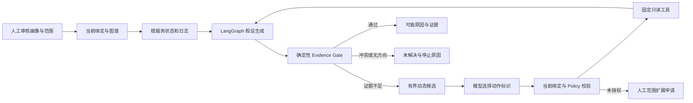

# ATR V2.2 架构

保留 FastAPI、SQLite、LangGraph、LiteLLM、React、业务画像、Context Budget、Evidence Gate 和人工审核 Trusted Pattern。实现基于 V2.1 main `aafd8183fa055f68138b432a788ec7831c9b9698`，仅本地分支，未发布。

## 调查路径

normal 与 graph_adaptive 使用 AdaptiveInvestigationPlanner；graph_only 与 graph_pattern 保留受限固定基线，用于对照。normal 可接收 Trusted 检查建议，但历史经验不计为当前证据。资料上传仍是受限 Worker 解析，不运行上传项目代码。

## 动作与假设

每轮最多三个活动机制假设，按目标图节点和故障机制形成稳定标识。每轮保留支持、反证、缺失证据、预测和 candidate/supported/refuted/unresolved 状态。被省略的反证从历史恢复，模型无法通过省略将其抹除。轮次保存在 diagnostic_steps.action_json，完整历史与停止原因在 diagnosis_runs.summary_json，沿用原数据库表。

候选从当前服务及图上上下游、已确认运行对象、授权目录列表、列出的具体配置文件、资料索引搜索结果扩展。最多返回十二项；相关性、假设区分度、新信息、读取成本、上下文成本、重复及权限形成调度因素。评分辅助模型选择，参数由服务端构造。动作标识哈希包含工具、业务目标、运行主机和完整参数，不把不同配置文件或源码文件视为同一动作。

模型选择 action_id；Policy 与工具 Schema 独立校验，执行前再检查绑定时效。所有模型消息按对象递归脱敏后 JSON 序列化，避免正则替换破坏 JSON。工具超时、拒绝、失败保留不同审计状态。失败动作不会无限重试。

## 证据门与预测

原 Gate 的目标/角色、当前图谱、故障窗口、两条不同事实、两类观察、失败信号、因果解释、无冲突/反证和非离线约束全部保留。新增 Hypothesis Verification 仅收紧支持条件。

预测支持固定状态、HTTP 状态、监听和限定日志信号的可行性检查；预测是检查提议，不是可执行工具参数。核验结果为 verified/refuted/missing/infeasible。兼容旧的启动状态文本预测，以固定失败状态集合进行核验。具体因果最低规则当前覆盖 startup_failure、permission_denied、bind_failure、database_unavailable、redis_unavailable；未知机制保持候选，不能仅因状态预测成立而确认。

必须存在本次故障窗口内匹配机制的日志及独立目标状态。普通 ERROR、历史示例、未来日志、静态资料和 Pattern 不能证明实时原因。检查相同调用/同一远端观测的相关性，自动把未被模型引用的相反健康状态/预测反证加入假设链接。输出区分 phenomenon、correlated_anomaly、possible_cause；supported 表示此版本最低证据要求通过，不能证明更深层机制或已修复。

## 时效、任务和预算

人工授权与当前运行事实分开。service_bindings 增量增加 freshness_status、observed_at、expires_at、source_json、candidate_digest。失败/部分发现保留已确认授权；完整新证据判定 stale、身份变化或需重新审核。过期事实不进入调查图和候选。schema 22 前生成 pre-v22 SQLite 一致备份，保留原有数据与迁移历史。

同事件活动任务在 SQLite BEGIN IMMEDIATE 内原子复用，重复请求不新建预算或提交重复 Worker。任务条件领取；异常和重启明确终止 run/job/pending tools，并保守结算未完成模型预算。继续单 API 进程；未引入外部队列。

Context Budget 继续在调用前预留 UTF-8 字节上界，限制请求输入、上下文窗口、调用数、累计 tokens、工具数和读取量。供应商 usage 与估算分别标记，费用仅按配置费率估算，缺费率为未知。预算或轮数、权限、冲突、无新方向均明确终止，证据不足维持 unresolved。

## SSH 边界

客户端固定工具和 Schema，服务器 forced-command 入口 atr-read-v1 配合管理员维护的独立策略、非特权账号和只读目录；禁止自由 Shell、修改服务和任意命令。清单用固定原生工具流式有界采集，最多扫描 2048 条/1 MiB/8 秒，加有限终止等待，返回 partial/truncated/timeout。名称线索、固定上限和游标用于发现，不自动授权。

客户端白名单不等于服务器只读。Docker Collector 只适用可信隔离 Demo，宿主 Docker socket 即使只读挂载仍具有 daemon 风险。真实服务器必须由所有者明确授权。

## 验证范围

实际环境与测试结果以 [验收记录](v2.2-development-report.md) 为准。核心自动化使用隔离临时 SQLite、Mock 连接器、Stub 模型及本机浏览器；它们不能替代真实 Linux 账号、Docker 部署或模型供应商验收。
